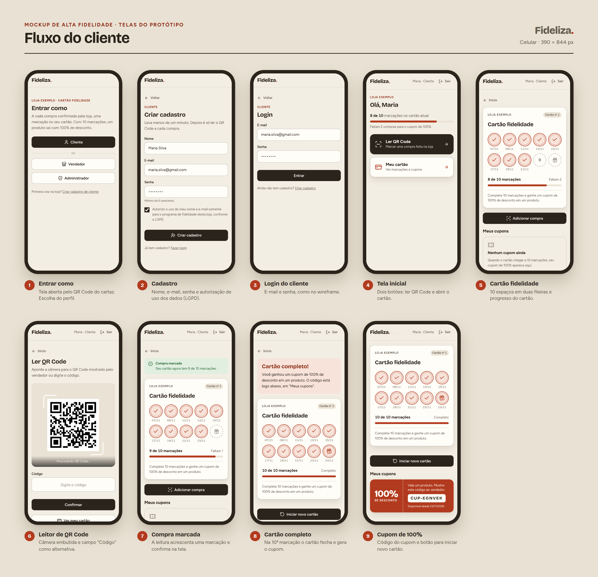
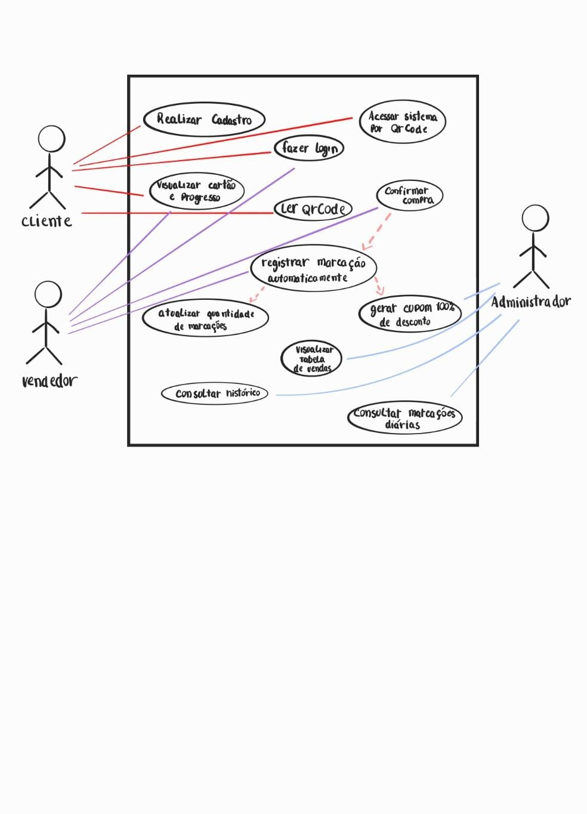
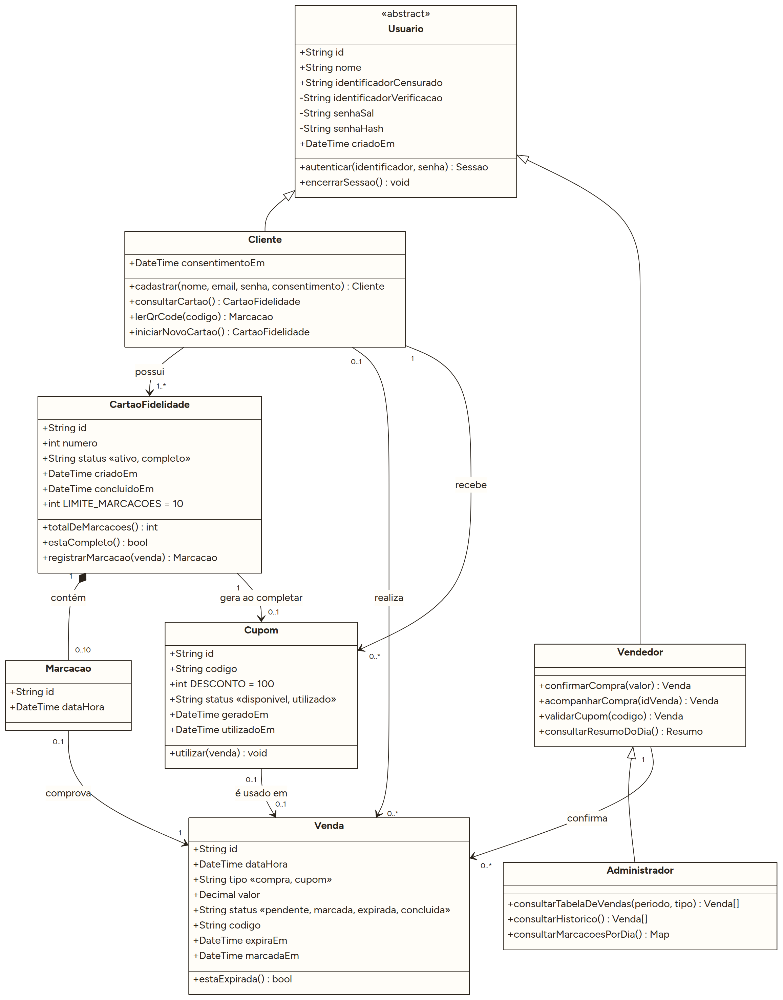
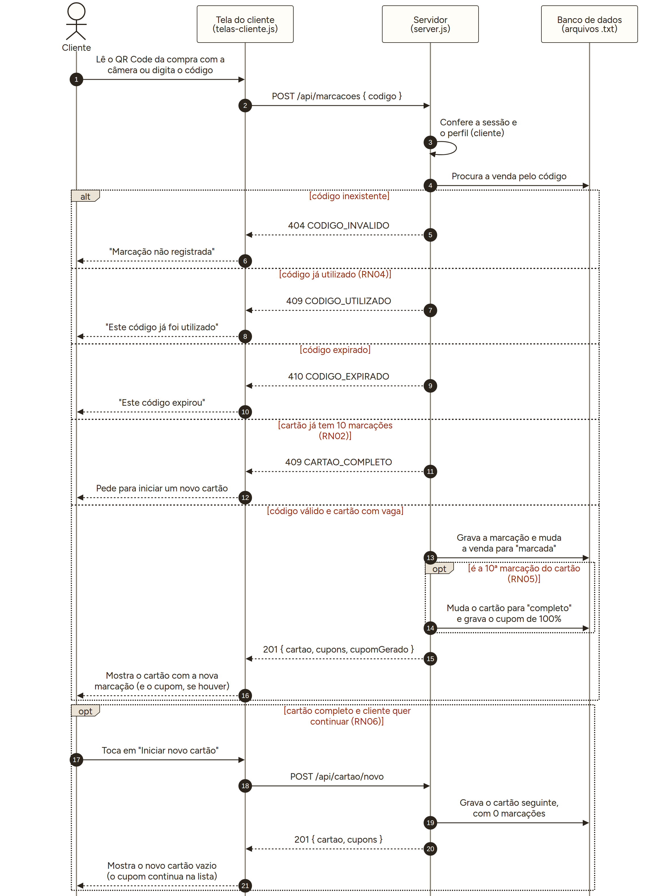
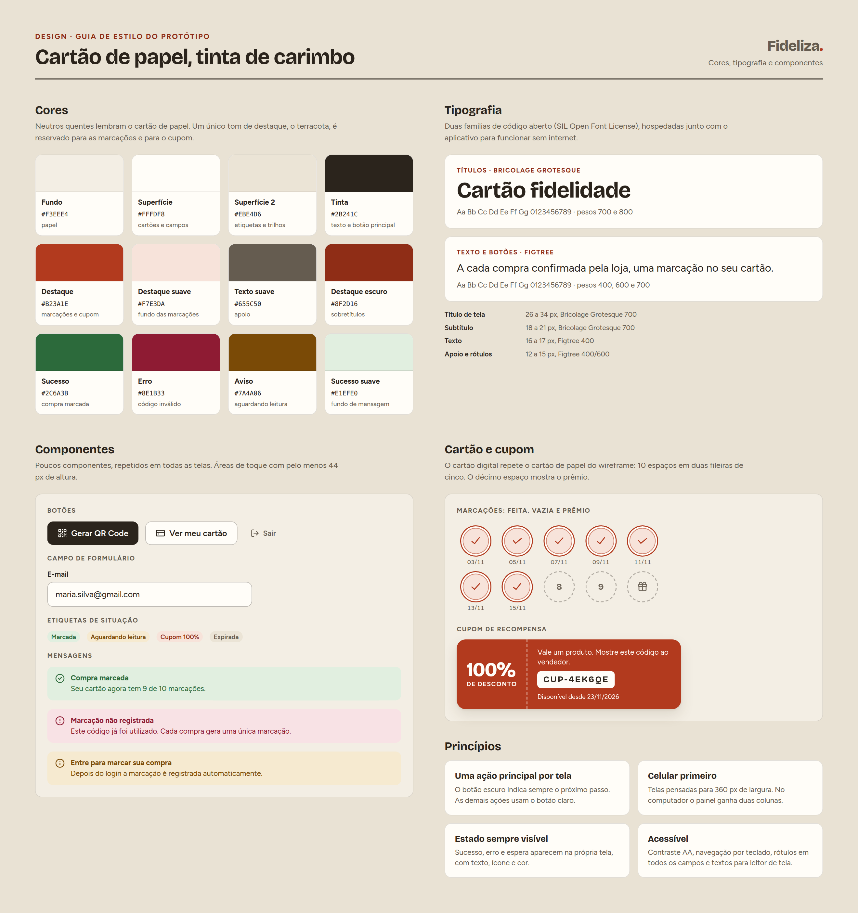

# Fideliza cartão fidelidade digital

Protótipo funcional que digitaliza o cartão de fidelidade de papel de uma loja. O cliente lê um QR Code no balcão, o vendedor confirma a compra e o cartão ganha uma marcação. Na 10ª marcação o cliente recebe um cupom de 100% de desconto em um produto.

Projeto da avaliação A3 da unidade curricular **Projeto e Engenharia de Software** (Ciências da Computação), desenvolvido com a metodologia ágil **Scrum**.



## Integrantes

| Nome | RA |
| --- | --- |
| Bridget Caroline Monay Bolivar da Costa | 826194982 |
| Eduarda Capelas Barbosa | 8261115447 |
| Gabriel Caique Zerbinato Alcantara | 826216891 |
| Geovanna Rodrigues Petarnella de Oliveira | 826171997 |

## Sobre esta versão

Este repositório contém a **versão de demonstração**, feita só com HTML, CSS e JavaScript. O banco de dados é simulado na memória do navegador:

- funciona com **qualquer e-mail e qualquer senha**;
- **não salva nada**: ao recarregar ou fechar a página, tudo volta ao início;
- não precisa de instalação, servidor ou internet.

A outra versão do projeto (`fideliza-local`) grava os dados em arquivos `.txt` com e-mails censurados e senhas protegidas. Ela é entregue à parte, porque precisa do Node.js para gravar arquivos no computador.

## Como abrir

1. Baixe o repositório (botão **Code → Download ZIP**) e descompacte.
2. Abra o arquivo `index.html` no navegador.

[Ou acessar pelo site no GitHub Pages](https://barelyhere-edu.github.io/Fideliza._ProjetoEng/)

## Como testar

| Perfil | Como entrar |
| --- | --- |
| Cliente | Qualquer e-mail e qualquer senha |
| Vendedor | Qualquer CNPJ com 14 números e qualquer senha |
| Administrador | Qualquer CNPJ com 14 números e qualquer senha |

Para ver o cliente e a loja conversando, abra o site em **duas abas do mesmo navegador**:

1. **Aba da loja:** Entrar como Vendedor → "Confirmar compra" → "Gerar QR Code". Aparecem o QR Code e um código de 6 caracteres, válidos por 5 minutos.
2. **Aba do cliente:** Entrar como Cliente → "Ler QR Code" → digite o código (ou aponte a câmera para o QR Code). O cartão ganha uma marcação e a aba da loja muda sozinha para "Compra marcada".
3. O cartão de demonstração já começa com **8 marcações**, para que a 10ª chegue rápido. Repita os passos 1 e 2 mais uma vez: o cartão fica completo e aparece o cupom (`CUP-XXXXXX`).
4. **Aba da loja:** "Validar cupom" → digite o código do cupom.
5. **Aba do cliente:** "Iniciar novo cartão".
6. **Aba da loja:** saia e entre como Administrador para ver a "Tabela de vendas".

O sistema deve recusar: o mesmo código usado duas vezes, um código vencido, a 11ª marcação no mesmo cartão, o mesmo cupom validado duas vezes e a tabela de vendas aberta por um vendedor.

**Sobre a câmera:** os navegadores só liberam a câmera para páginas em `https://` ou em `localhost`. Pelo GitHub Pages (que usa `https`) o leitor funciona. Com o arquivo aberto direto do computador, alguns navegadores não liberam a câmera; nesse caso, use o campo para digitar o código.

## Funcionalidades

**Cliente**

- Cadastro e login.
- Cartão fidelidade com 10 espaços e progresso.
- Leitor de QR Code pela câmera ou código digitado.
- Cupons ganhos e início de um novo cartão.

**Vendedor**

- Login com o CNPJ da loja.
- Confirmação de compra com QR Code de uso único.
- Validação do cupom do cliente.
- Cartaz com o QR Code de acesso da loja.

**Administrador**

- Tudo o que o vendedor faz.
- Tabela de vendas com filtros e histórico.
- Marcações por dia e vendas feitas com cupom.

## Regras de negócio

| ID | Regra |
| --- | --- |
| RN01 | O sistema funcionará por meio de um cartão de fidelidade digital. |
| RN02 | Cada cliente poderá acumular até 10 marcações por cartão. |
| RN03 | Cada compra deverá ser confirmada pelo vendedor antes de gerar uma marcação. |
| RN04 | O sistema deverá impedir marcações duplicadas ou indevidas. |
| RN05 | Ao completar 10 marcações, o cliente receberá um cupom de 100% de desconto em um produto. |
| RN06 | Após completar o cartão, um novo ciclo de marcações poderá ser iniciado. |
| RN07 | O administrador poderá consultar o histórico de vendas e a quantidade de marcações realizadas. |

## Requisitos funcionais

| ID | Requisito |
| --- | --- |
| RF01 | Permitir o cadastro de clientes. |
| RF02 | Permitir login de clientes e vendedores. |
| RF03 | Disponibilizar acesso ao sistema por QR Code. |
| RF04 | Permitir que o cliente visualize seu cartão de fidelidade digital. |
| RF05 | Permitir a leitura de QR Code pelo aplicativo ou site. |
| RF06 | Permitir que o vendedor confirme uma compra. |
| RF07 | Registrar uma marcação após a confirmação da compra. |
| RF08 | Atualizar automaticamente a quantidade de marcações no cartão do cliente. |
| RF09 | Exibir o progresso do cartão de fidelidade. |
| RF10 | Gerar um cupom de 100% de desconto após 10 marcações. |
| RF11 | Permitir que o administrador visualize a tabela de vendas. |
| RF12 | Exibir a quantidade de marcações realizadas diariamente. |
| RF13 | Armazenar o histórico de compras e marcações. |
| RF14 | Impedir que o cliente ultrapasse o limite de 10 marcações por cartão. |

Durante a prototipação surgiram mais sete requisitos (RF15 a RF21), descritos e justificados na seção 4.2 da documentação.

## Requisitos não funcionais

| ID | Requisito |
| --- | --- |
| RNF01 | O sistema deverá possuir uma interface simples e intuitiva. |
| RNF02 | Deverá funcionar em dispositivos móveis e computadores. |
| RNF03 | Os dados dos clientes deverão ser armazenados com segurança. |
| RNF04 | O acesso às funcionalidades deverá respeitar o perfil de cada usuário. |
| RNF05 | A leitura do QR Code deverá ocorrer de maneira rápida. |
| RNF06 | O sistema deverá estar disponível durante o horário de funcionamento da loja. |
| RNF07 | Deverá impedir acessos não autorizados. |
| RNF08 | Deverá proteger os dados pessoais dos clientes, respeitando a LGPD. |

## Modelagem

Os diagramas de classes e de sequência foram escritos em Mermaid. Os arquivos-fonte (`.mmd`) estão em `docs/diagramas/`, ao lado das imagens.

### Diagrama de casos de uso



### Diagrama de classes



### Diagramas de sequência

| Fluxo | Imagem | Fonte |
| --- | --- | --- |
| Cadastro e login do cliente | [PNG](docs/diagramas/sequencia-1-cadastro-e-login.png) | [Mermaid](docs/diagramas/sequencia-1-cadastro-e-login.mmd) |
| Confirmar compra | [PNG](docs/diagramas/sequencia-2-confirmar-compra.png) | [Mermaid](docs/diagramas/sequencia-2-confirmar-compra.mmd) |
| Registrar marcação e iniciar novo cartão | [PNG](docs/diagramas/sequencia-3-registrar-marcacao.png) | [Mermaid](docs/diagramas/sequencia-3-registrar-marcacao.mmd) |
| Validar cupom | [PNG](docs/diagramas/sequencia-4-validar-cupom.png) | [Mermaid](docs/diagramas/sequencia-4-validar-cupom.mmd) |



## Wireframe, design e mockups

| Etapa | Arquivo |
| --- | --- |
| Wireframe (desenho inicial das telas) | [docs/wireframe/wireframe.jpg](docs/wireframe/wireframe.jpg) |
| Guia de estilo (cores, tipografia e componentes) | [docs/design/guia-de-estilo.png](docs/design/guia-de-estilo.png) |
| Mockup do fluxo do cliente | [docs/mockups/mockup-cliente.png](docs/mockups/mockup-cliente.png) |
| Mockup do fluxo da loja | [docs/mockups/mockup-loja.png](docs/mockups/mockup-loja.png) |
| Mockup no computador | [docs/mockups/mockup-desktop.png](docs/mockups/mockup-desktop.png) |



## Estrutura do repositório

```
index.html              estrutura da página
css/style.css           todo o visual (cores, tipografia, componentes, layout responsivo)
js/config.js            nome da loja e constantes das regras (10 marcações, 100% de desconto)
js/api.js               camada de dados simulada (banco de dados fake, na memória)
js/app.js               navegação entre as telas e controle de acesso por perfil
js/telas-acesso.js      telas "Entrar como", login e cadastro
js/telas-cliente.js     cartão, leitor de QR Code e cupons
js/telas-loja.js        painel da loja, QR Code da compra, cupom, tabela de vendas e cartaz
js/leitor.js            liga a câmera e procura o QR Code na imagem
js/ui.js, js/icones.js  funções de apoio e ícones
js/vendor/              bibliotecas de terceiros (geração e leitura de QR Code)
assets/fonts/           fontes usadas nas telas
docs/                   documentação, diagramas, wireframe, guia de estilo e mockups
```

As telas nunca acessam os dados diretamente: elas chamam o objeto `Fideliza.api`, definido em `js/api.js`. Esse é o único arquivo que muda entre a versão de demonstração e a versão local.

## Documentação

A documentação completa está em [`docs/Documentacao-Fideliza.docx`](docs/Documentacao-Fideliza.docx): apresentação do projeto, organização em Scrum (papéis, backlog, sprints e retrospectivas), regras de negócio, requisitos, diagramas com justificativas, wireframe, design, mockups, arquitetura do protótipo, segurança e LGPD, e testes.

## Tecnologias e licenças

| Tecnologia | Uso | Licença |
| --- | --- | --- |
| HTML, CSS e JavaScript | Telas e regras da versão de demonstração | Padrões abertos da web |
| qrcode-generator 2.0.4 | Desenha os QR Codes | MIT |
| jsQR 1.4.0 | Lê o QR Code na imagem da câmera | Apache-2.0 |
| Lucide | Ícones | ISC |
| Bricolage Grotesque e Figtree | Fontes dos títulos e dos textos | SIL Open Font License 1.1 |
| Mermaid | Desenho dos diagramas de classes e de sequência | MIT |

Os textos das licenças estão em `js/vendor/LICENCAS.txt` e `assets/fonts/LICENCA.txt`.

## Limites do protótipo

- O nome "Fideliza" e a loja "Loja Exemplo" são provisórios e ficam em `js/config.js`.
- Na versão de demonstração, cliente e loja só conversam entre abas do **mesmo navegador**.
- Ainda não há recuperação de senha nem tela para o cliente corrigir ou excluir o próprio cadastro.
